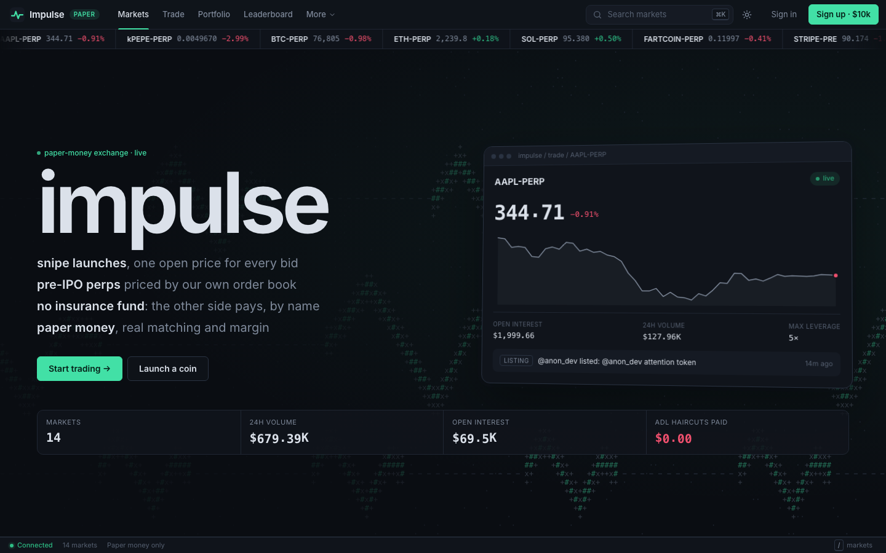
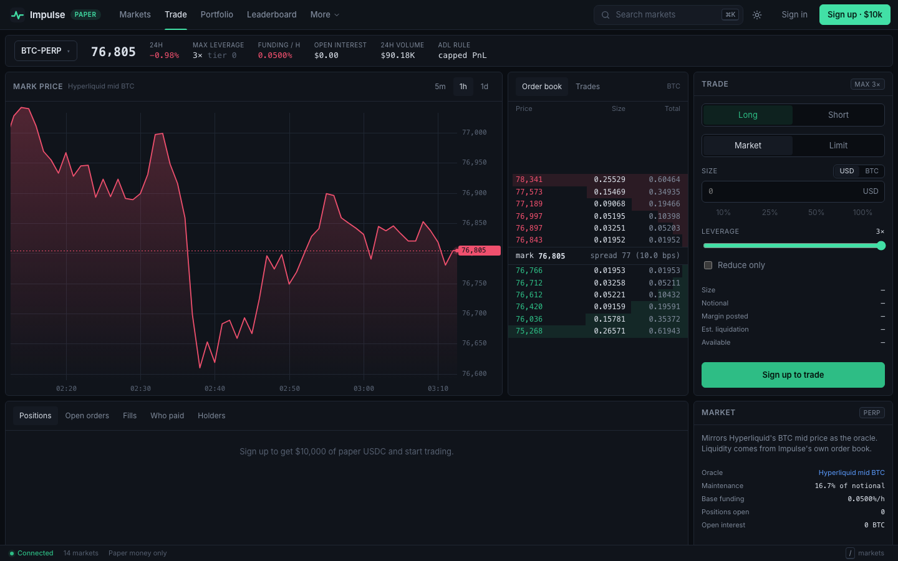
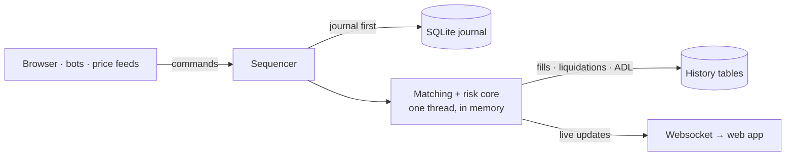

# Impulse

**A paper-trading exchange for MicroPerps: leveraged perps on anything, with no insurance fund behind them.**

**Live demo: [impulse.sidkap.xyz](https://impulse.sidkap.xyz)** · play money only, sign up for $10k of paper USDC.
The first visit after a quiet spell takes a few seconds while the server wakes up.



## What it does

| | |
|---|---|
| **Creator coins** | Type a handle and a coin exists. A 60-second snipe window opens, and every sniper gets the same open price. Then it trades on a bonding curve, with a leveraged long/short perp on top. |
| **Pre-IPO perps** | Leverage on private companies with no outside price: the mark is whatever the market's own order book settles on, until an IPO gaps it to a public price. |
| **ADL instead of an insurance fund** | When a position goes below zero, the shortfall comes out of the winners on the other side in the same transaction. Every event records who paid, and the UI shows it. |

Crypto and stock perps (Hyperliquid prices, with Hyperliquid's real order book mirrored into ours) and
prediction-market perps (Polymarket) run on the same engine. House bots make markets and trade, so there's always
something happening.



## How it works



- **One deterministic core.** Every state change (an order, a price tick, the clock) is a numbered command. Matching,
  liquidation and ADL run on one thread, and the same commands always produce the same state.
- **Journal before reply.** Each command is written to SQLite before the client hears back, so a crash loses
  nothing acknowledged. Restarts load the latest snapshot and replay the rest.
- **Solvent after every step.** The engine checks its invariants (balances, open interest, collateral) after every
  command. Ordinary rule breaks, like too little margin, are refused; an invariant failure stops the server rather
  than let a bad state reach the journal.

The model, invariants and proofs are in [docs/ACCOUNTING.md](docs/ACCOUNTING.md); the design choices are in
[docs/DECISIONS.md](docs/DECISIONS.md).

## Run it locally

Needs Rust (cargo) and pnpm.

```bash
OFFLINE=1 make start   # http://localhost:8787 with simulated prices; drop OFFLINE=1 for live ones
make dev               # Rust server + Vite with hot reload on http://localhost:5173
make test              # all Rust tests: engine, parity, HTTP + websocket, crash recovery
make typecheck         # the web app
```

The local admin token is `impulse-admin`. The 5-minute demo script, the API and every setting are in
[docs/MVP.md](docs/MVP.md).

## Stack

| | |
|---|---|
| Engine | Rust, exact integer money (no floats), `crates/engine` |
| Server | Rust: axum, tokio, websockets, SQLite (rusqlite), `crates/server` |
| Web | React, TanStack Router / Query / Form / Pacer, zustand, a custom canvas chart, `web/` |
| Hosting | Web app on Cloudflare; the exchange on one Fly.io machine with a volume for the database ([docs/DEPLOY.md](docs/DEPLOY.md)) |

## Layout

| Path | What it is |
|---|---|
| `crates/engine` | Risk engine: margin, liquidation, ADL, funding, leverage graduation, bonding curves, launches |
| `crates/server` | Exchange: order books, matching, API, feeds, bots, command journal, snapshots, history |
| `web/` | Trading UI (its own pnpm project, the only Node code here) |
| `tests/` | Test data: event `scenarios/` and `golden/` results from the original TypeScript engine |
| `docs/` | [MVP](docs/MVP.md) · [API contract](docs/API-CONTRACT.md) · [Accounting](docs/ACCOUNTING.md) · [Decisions](docs/DECISIONS.md) · [Deploy](docs/DEPLOY.md) |

## Background

Impulse is modelled on the MicroPerps design that Mirror describes. The research behind it (findings, sources,
simulations) and the TypeScript engine it was first built in live in the private
[impulse-research](https://github.com/SidharthK2/impulse-research) repo. Nothing there is needed to build, run or
test the app.
